<a href="https://ahmadsyahani.app"><picture><source media="(max-width: 600px)" srcset="./cards/hero-mobile.svg" /></picture></a> 
<a href="https://github.com/ahmadsyahani?tab=overview"><picture><source media="(max-width: 600px)" srcset="./cards/heatmap-mobile.svg" /></picture></a> 
<picture><source media="(max-width: 600px)" srcset="./cards/activity-mobile.svg" /></picture> 
<a href="https://github.com/ahmadsyahani?tab=repositories"><picture><source media="(max-width: 600px)" srcset="./cards/build-mobile.svg" /></picture></a><a href="https://github.com/ahmadsyahani/Nexa"><picture><source media="(max-width: 600px)" srcset="./cards/mobile-mobile.svg" /></picture></a><a href="https://github.com/ahmadsyahani?tab=repositories"><picture><source media="(max-width: 600px)" srcset="./cards/code-mobile.svg" /></picture></a> 
<picture><source media="(max-width: 600px)" srcset="./cards/projects-title-mobile.svg" /></picture> 
<a href="https://github.com/ahmadsyahani/ShipX-Delivery"><picture><source media="(max-width: 600px)" srcset="./cards/repo-ShipX-Delivery-mobile.svg" /></picture></a><a href="https://github.com/ahmadsyahani/Nexa"><picture><source media="(max-width: 600px)" srcset="./cards/repo-Nexa-mobile.svg" /></picture></a><a href="https://github.com/ahmadsyahani/ahmadsyahani.app"><picture><source media="(max-width: 600px)" srcset="./cards/repo-ahmadsyahani.app-mobile.svg" /></picture></a>

<a href="https://ahmadsyahani.app">Website</a> &nbsp;/&nbsp; <a href="https://github.com/ahmadsyahani">GitHub</a>

