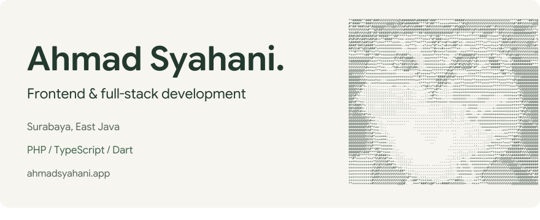
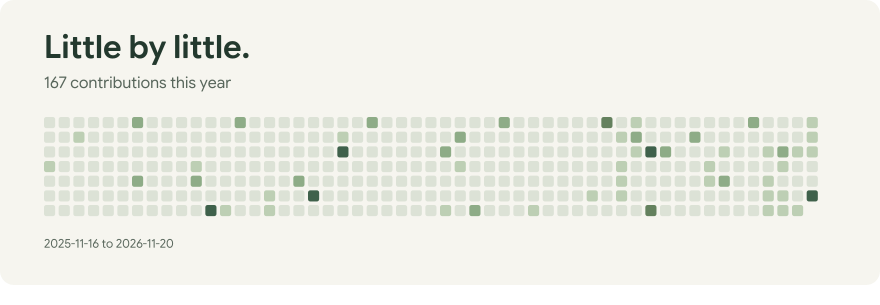
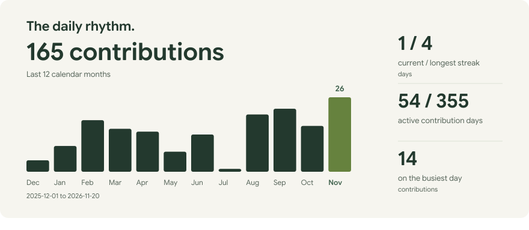
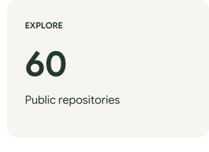

<a href="./README.md">Resume animations</a>

<a href="https://ahmadsyahani.app"><picture><source media="(max-width: 600px)" srcset="./cards/static/versions/hero-mobile-495fa11715.svg" /></picture></a> 
<a href="https://github.com/ahmadsyahani?tab=overview"><picture><source media="(max-width: 600px)" srcset="./cards/static/versions/heatmap-mobile-41f7d43dc7.svg" /></picture></a> 
<picture><source media="(max-width: 600px)" srcset="./cards/static/versions/activity-mobile-9e26dbbfa4.svg" /></picture> 
<a href="https://github.com/ahmadsyahani?tab=repositories"><picture><source media="(max-width: 600px)" srcset="./cards/static/versions/build-mobile-84eec3c456.svg" /></picture></a><a href="https://github.com/ahmadsyahani/Nexa"><picture><source media="(max-width: 600px)" srcset="./cards/static/versions/mobile-mobile-437cc97d7f.svg" /></picture></a><a href="https://github.com/ahmadsyahani?tab=repositories"><picture><source media="(max-width: 600px)" srcset="./cards/static/versions/code-mobile-80915a8457.svg" /></picture></a> 
<picture><source media="(max-width: 600px)" srcset="./cards/static/versions/projects-title-mobile-0a7172e5a9.svg" /></picture> 
<a href="https://github.com/ahmadsyahani/ShipX-Delivery"><picture><source media="(max-width: 600px)" srcset="./cards/static/versions/repo-ShipX-Delivery-mobile-c4dfff7a0d.svg" /></picture></a><a href="https://github.com/ahmadsyahani/Nexa"><picture><source media="(max-width: 600px)" srcset="./cards/static/versions/repo-Nexa-mobile-2f4fb0d6c4.svg" /></picture></a><a href="https://github.com/ahmadsyahani/ahmadsyahani.app"><picture><source media="(max-width: 600px)" srcset="./cards/static/versions/repo-ahmadsyahani.app-mobile-34fd5e9c5b.svg" /></picture></a>

<a href="https://ahmadsyahani.app">Website</a> &nbsp;/&nbsp; <a href="https://github.com/ahmadsyahani">GitHub</a>

